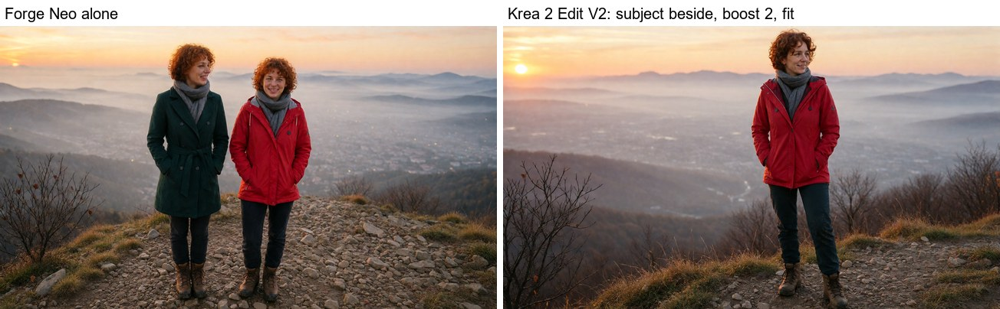
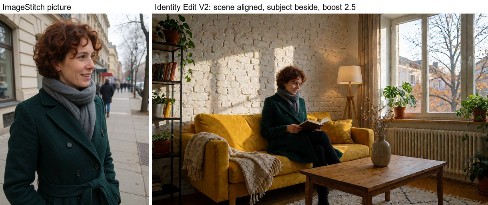
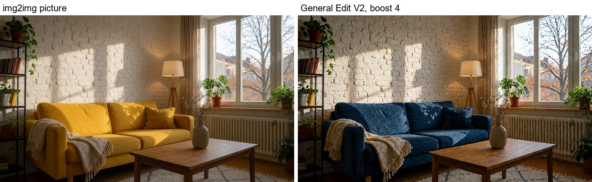

# ✏️ Krea 2 Edit V2 for Forge Neo

> **Extension for [Stable Diffusion WebUI Forge - Neo](https://github.com/Haoming02/sd-webui-forge-classic/tree/neo)**

The controls of the **[Krea 2 Identity Edit V2 and General Edit V2](https://huggingface.co/conradlocke/krea2-identity-edit)** LoRAs inside Forge Neo: reference boost, reference placement (aligned or beside), the fit the V2 LoRAs were trained with, and the grounding size - the inputs the [ComfyUI-Krea2Edit 2.0 nodes](https://github.com/lbouaraba/comfyui-krea2edit) added, on top of the Krea 2 edit Forge Neo already has.

> [!Important]
> This extension requires an up-to-date **Forge Neo** (the `neo` branch) with its own Krea 2 Edit. On another version it stays disabled and tells you so in the console - Forge Neo itself keeps working as usual. If your Forge Neo gets these controls by itself, the extension steps aside and says so.

---

## 📋 Table of Contents

- [What's New](#-whats-new)
- [Features](#-features)
- [Installation](#-installation)
- [Recommended Settings](#%EF%B8%8F-recommended-settings)
- [Tips](#-tips)
- [Credits](#-credits)

---

## 🆕 What's New

### v0.1.0 - First Release

- **Krea 2 Edit V2 accordion** in txt2img and img2img
- **Subject and scene boost** - how hard the result follows each picture (upstream's `ref_boost` / `ref_boost_a`)
- **Placement** - aligned, beside or bag of features, for the subject and for the scene (`ref_position` / `ref_position_a`)
- **Fit** - pictures of other proportions are fitted in pixels, the way the V2 LoRAs were trained, instead of resized as latents
- **Grounding size** - the longest side the text encoder sees each picture at, and the pictures shown with the negative prompt too
- Saved in the generation info and restored by **PNG Info → Send to**

---

## 🎯 Features

### 🧭 How Forge Neo's Krea 2 Edit Works

Forge Neo runs Krea 2 edit LoRAs by itself: with **Settings → Stable Diffusion → [Krea2] Enable Reference** on, the img2img picture and the ImageStitch pictures become references the model sees next to the result, and the prompt is the edit instruction. The V2 LoRAs were trained with more control over those references than Forge Neo exposes; this extension adds it, and changes nothing while its accordion is closed.

### 🧑 Subject and Scene

- The pictures to edit are, in order, the **img2img picture** and the **ImageStitch** pictures
- The **last** picture is the **subject** - the person in a two-picture edit, or the only picture
- The pictures before it are the **scene**
- Putting a person into a room: the room in img2img, the person in ImageStitch

### 💪 Boost

- **Subject boost** multiplies how much the result attends to the subject picture; 1 is off, above 1 pulls harder toward the picture's look, below 1 loosens it
- **Scene boost** does the same for the scene pictures
- The LoRA's author recommends 2 for the Identity Edit V2 (2-3 for the person with a scene at 1) and 4 for the General Edit V2

### 📐 Placement

- **aligned** - the picture is pinned onto the result's layout, how the LoRAs were trained; best when the layout should stay: edits, face-locked portraits, the scene of a composite
- **beside** - the picture sits next to the result: the identity still flows, but the layout pin is gone, so the person can be restaged more freely
- **bag of features** - experimental: the picture's content without its layout
- Scene aligned and subject beside gives the most natural composites

### 🖼️ Fit

- **fit** - a picture of other proportions is fitted inside the result in pixels, on the model's 16-pixel grid, and keeps its own place - the V2 geometry
- **crop (legacy)** - the picture is center-cropped to the result's proportions; for the v1 and v1.1 LoRAs
- Both fit the picture in pixels before the autoencoder, where Forge Neo resizes the latent, which softens it
- A portrait photo in a landscape result stays its own size with fit, so the model reads fewer reference tokens: putting the woman above into the room took 6 minutes instead of 18 in our test on an RTX 2070

### 🔎 Grounding

- The text encoder (Qwen3-VL) reads the instruction together with each picture; **Grounding size** caps the longest side it sees, 768 by default (the LoRAs trained with 384 to 768); 0 shows the picture as it is
- **Ground the negative prompt** shows the pictures with the negative prompt too, as the LoRA's author recommends above CFG 1; at CFG 1 Forge Neo skips the negative prompt anyway

### 🛡️ Safe by Design

- Changes no Forge Neo file - remove the extension and everything is as it was
- Checks your Forge Neo at startup and stays disabled if something it needs is missing
- With the accordion closed, or with another model, Forge Neo's own path runs untouched
- With every control at its neutral value (boosts 1, aligned), the model gets exactly what Forge Neo's own edit gives it, apart from the fit and grounding

---

## 📦 Installation

1. Open Forge Neo WebUI
2. Go to **Extensions** → **Install from URL**
3. Paste: `https://github.com/eduardoabreu81/krea2-edit-forge-neo`
4. Click **Install** and restart the WebUI
5. Download a LoRA from [conradlocke/krea2-identity-edit](https://huggingface.co/conradlocke/krea2-identity-edit) into `models/Lora`:

| LoRA | For | Files |
| :--- | :--- | :--- |
| Krea 2 Identity Edit V2 | putting a person from one photo into any scene, pose, outfit and light | `krea2_identity_edit_v2` (1.8 GB), `_r128` (0.9 GB), `_r64` (0.46 GB) |
| Krea 2 General Edit V2 | instruction edits: remove, recolor, relight, backgrounds, objects, text, outfits, styles | `krea2_general_edit_v2` (1.8 GB), `_r128`, `_r64` |

6. Turn on **Settings → Stable Diffusion → [Krea2] Enable Reference**

> [!Note]
> Tested on an RTX 2070 (8 GB), Forge Neo 2.31, with a Krea 2 INT8 checkpoint, the Qwen3-VL 4B INT8 text encoder and the `_r64` files of both V2 LoRAs, 8 steps at CFG 1: an img2img edit with the General Edit, a person put into an img2img room through ImageStitch and a txt2img restage from one ImageStitch photo with the Identity Edit. Not tested yet: CFG above 1 (the grounded negative prompt), hires fix, and running together with other Krea 2 extensions that hook the same model.

---

## ⚙️ Recommended Settings

From the LoRA's model card, with Krea 2 Turbo:

| Use | LoRA | Steps | CFG | Subject boost | Scene boost | Placement |
| :--- | :--- | :--- | :--- | :--- | :--- | :--- |
| Restage one person (one picture) | Identity V2 | 8 | 1 | 2 | - | beside or aligned |
| Add a person to a scene (scene in img2img, person in ImageStitch) | Identity V2 | 8 | 1 | 2-3 | 1 | scene aligned, subject beside |
| Face-locked portrait (keep the photo's framing) | Identity V2 | 8 | 1 | 1-2 | - | aligned |
| Most edits | General V2 | 8 | 1 | 4 | - | aligned |
| Removals, large deletions (Krea 2 Raw) | General V2 | 20 | 3 | 4 | - | aligned |

Grounding size 768, fit. In img2img, set **Denoising strength** to 1. Generate at 2 megapixels or less.

---

## 💡 Tips

- Use one LoRA at a time: both at strength 1 give pure noise; about 0.6 each combines them
- Say how much of the person is visible ("full body", "sitting cross-legged on a log"), or the result tends to copy the photo's crop
- Describe the new outfit concretely and say what is gone ("remove her coat"): the model leans on the clothes in the photo
- Describe light by where it lands: "a magenta sign paints the left half of her face pink"
- Adding people one at a time works up to about seven

---

## 📄 Credits

- **[Forge Neo](https://github.com/Haoming02/sd-webui-forge-classic/tree/neo)** by Haoming02 - Krea 2 and its edit path
- **[Krea 2 Identity Edit / General Edit](https://huggingface.co/conradlocke/krea2-identity-edit)** and **[ComfyUI-Krea2Edit](https://github.com/lbouaraba/comfyui-krea2edit)** by Lars Bouaraba - the LoRAs, and the V2 controls this extension ports (Apache-2.0)
- **[Krea 2](https://huggingface.co/krea/Krea-2-Raw)** by Krea

The LoRAs are free for personal and non-commercial use; commercial use needs a license from their author - see the [model card](https://huggingface.co/conradlocke/krea2-identity-edit#license). This extension does not include them.

---

## 📜 License

AGPL-3.0 - see [LICENSE](LICENSE)

---

Made with ❤️ for the Stable Diffusion community

**[Report Bug](https://github.com/eduardoabreu81/krea2-edit-forge-neo/issues)** • **[Request Feature](https://github.com/eduardoabreu81/krea2-edit-forge-neo/issues)** • **[☕ Ko-fi](https://ko-fi.com/eduardoabreu81)**

